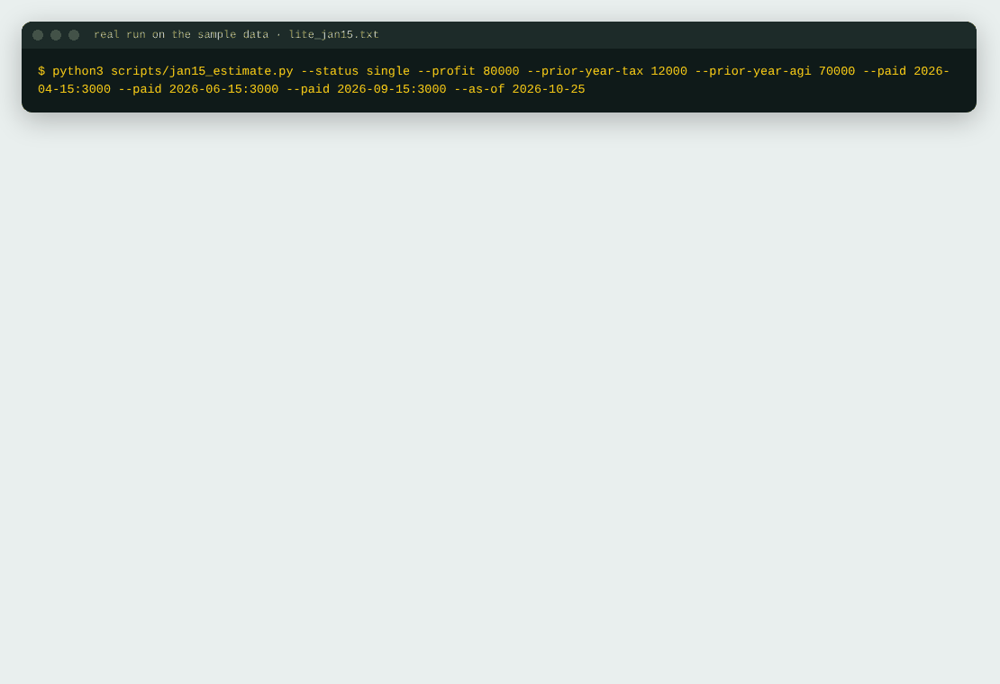
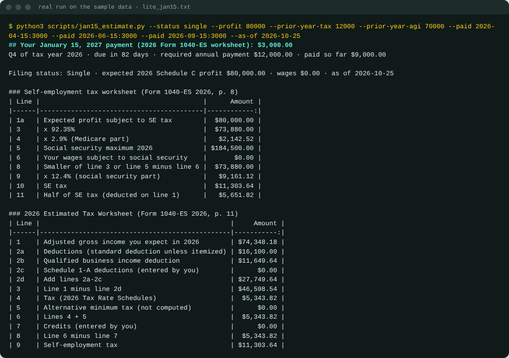
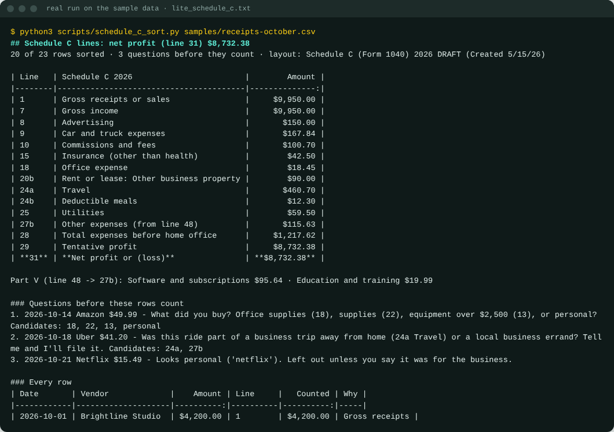
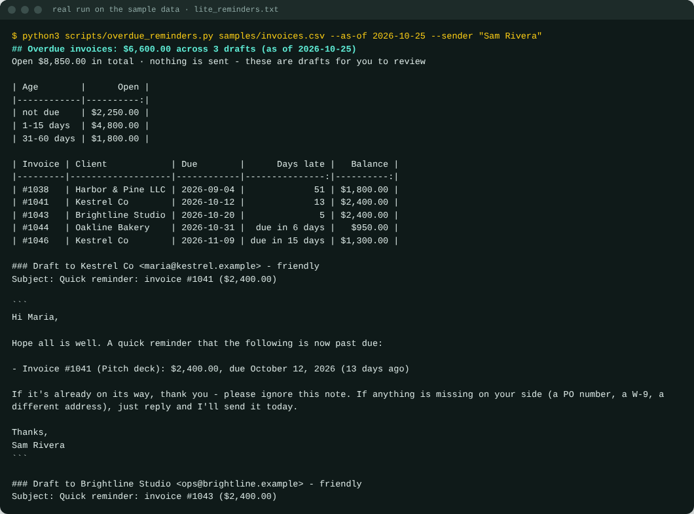

# Month-End Back Office (lite) - Claude skills for US freelancers

**Your January 15, 2027 estimated tax payment, worked out line by line on the 2026 Form 1040-ES worksheet - with the IRS source and the date it was read printed under the number.** Plus: a receipts CSV sorted into 2026 Schedule C lines, and reminder drafts for overdue invoices.



| January 15 payment | Receipts → Schedule C | Overdue invoices → drafts |
|---|---|---|
| [](docs/jan15-estimate.png) | [](docs/schedule-c-sort.png) | [](docs/overdue-reminders.png) |

*Screenshots are the real output of the scripts in this repo on the files in `samples/` (run on 2026-10-25).*

## Install in Claude Code

```
/plugin marketplace add jmshinhwa/month-end-back-office
/plugin install month-end-back-office-lite@readystack
```

Then ask Claude: **"What's my January 15 estimated tax payment?"** - it asks for your filing status, expected 2026 profit,
2025 tax and AGI and the payments you made, runs the worksheet, and shows the result with its sources.

Needs Python 3.8+ (standard library only). Your numbers stay on your computer; the scripts make no network calls.

## Or run the scripts yourself

```bash
python3 scripts/jan15_estimate.py --status single --profit 80000 --prior-year-tax 12000 --prior-year-agi 70000 \
    --paid 2026-04-15:3000 --paid 2026-06-15:3000 --paid 2026-09-15:3000
python3 scripts/schedule_c_sort.py samples/receipts-october.csv
python3 scripts/overdue_reminders.py samples/invoices.csv --sender "Your Name"
```

## Skills

| Skill | What it does |
|---|---|
| `jan-15-estimate` | 2026 Form 1040-ES worksheet line by line: SE tax (92.35%, 2.9%, 12.4% up to $184,500), 2026 rate schedules and standard deduction, QBI deduction with the $400 minimum, Additional Medicare Tax, safe harbor 90% / 100% / 110%, the $1,000 test, what is left for January 15, 2027 |
| `schedule-c-sort` | Receipts CSV → 2026 Schedule C lines (IRS 2026 **draft**: line 16b "Vehicle loan" is new), meals at 50%, mileage at 72.5¢ (Jan-Jun) / 76¢ (Jul-Dec 2026) by trip date, business-use %, every unsure row as a question |
| `overdue-reminder-drafts` | Aging table + one draft per client: friendly (1-14 days), firm (15-44), final notice (45+); late fees quoted only from your own terms; nothing is sent |

## Built on (IRS, read 2026-10-25)

Form 1040-ES (2026) · IR-2025-103 · Rev. Proc. 2025-32 · Schedule C 2026 draft (Created 5/15/26) · 2025 Instructions
for Schedule C and Schedule SE (latest posted) · IRS standard mileage rates (IR-2025-128, IR-2026-29) · Topic 560.
URLs and revisions are in [`data/irs_2026.json`](data/irs_2026.json) and print under every result.

Not computed: annualized method (Form 2210 Schedule AI), penalties, AMT, capital gains, state tax, QBI limits above the
2026 threshold, depreciation. Tax year 2027 is added after the IRS publishes it.

**This is a worksheet calculator using published IRS figures, not tax advice.**

## Pro: close the month, every month

[Month-End Back Office Pro](https://getreadystack.com/apps/freelancer-month-end-back-office-pack/) turns these into one
monthly run: receipt photos and email receipts → rows (duplicates skipped), a year-to-date ledger, your answers remembered
per vendor, the simplified home-office line, the next 1040-ES payment recomputed from your YTD profit, a payments log,
reminder escalation friendly → firm → final with a log, "what changed since last month", and a check that tells you when
the IRS replaces one of the source files.

MIT licence · made by [ReadyStack](https://getreadystack.com)
